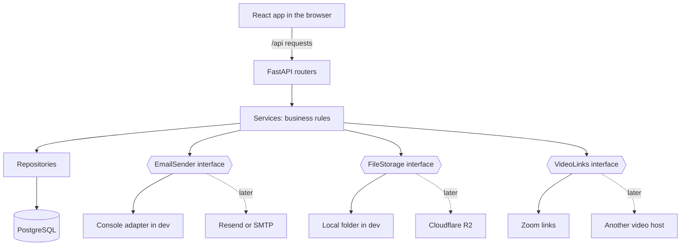

# Architecture

## Layers

Each layer may only call the layer below it.

```
api/        FastAPI routers: parse the request, call a service, return the response. No business rules.
services/   Business rules (who can enroll, when a recording link expires). No HTTP code.
repos/      Database queries only.
adapters/   Code that talks to outside providers, behind an interface:
            EmailSender, FileStorage, VideoLinks (Zoom today).
```

## Diagram



Dashed arrows are planned replacements. Swapping one means writing one adapter and changing one config value; services and routers stay the same.

## Folder map

```
backend/
  app/
    main.py        FastAPI app and router registration
    config.py      settings from environment variables (.env)
    db.py          SQLAlchemy base and engine factory
    api/           routers
    services/      business rules
    repos/         database queries
    adapters/      provider adapters behind interfaces
  migrations/      Alembic migrations
  tests/           pytest tests
frontend/          React + TypeScript (Vite); /api is proxied to the backend
docs/              this file, data model, flows, decisions, milestone checklists
```

## Rules

1. Secrets live in `.env` (never committed) and are read through `app/config.py`.
2. Routers never query the database directly.
3. Anything that calls an outside service goes through an adapter.
4. Every task updates the diagrams it changes (see TASKS.md, Definition of done).
